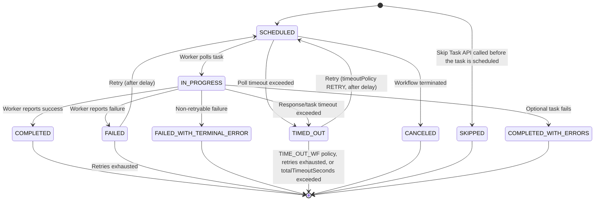
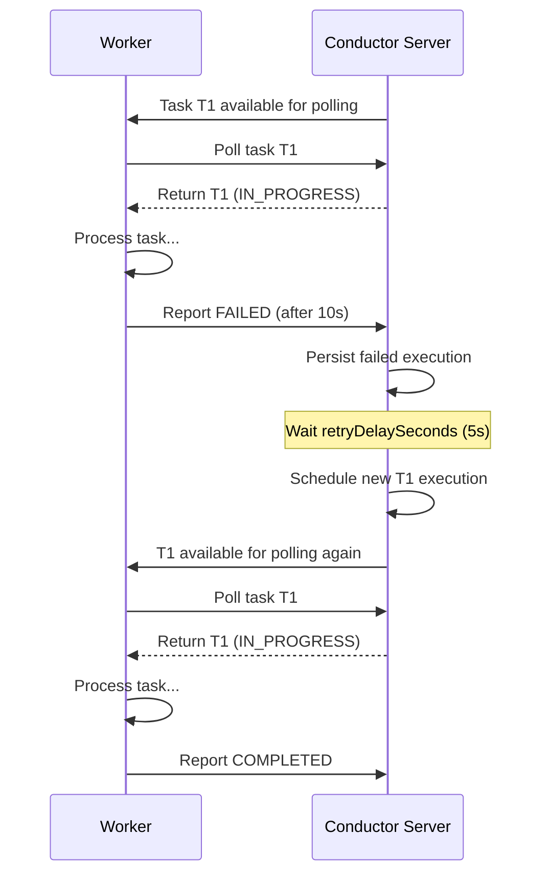
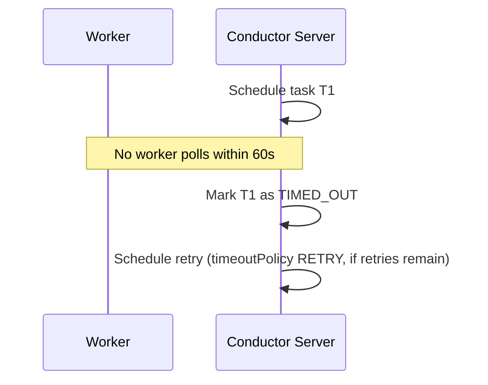
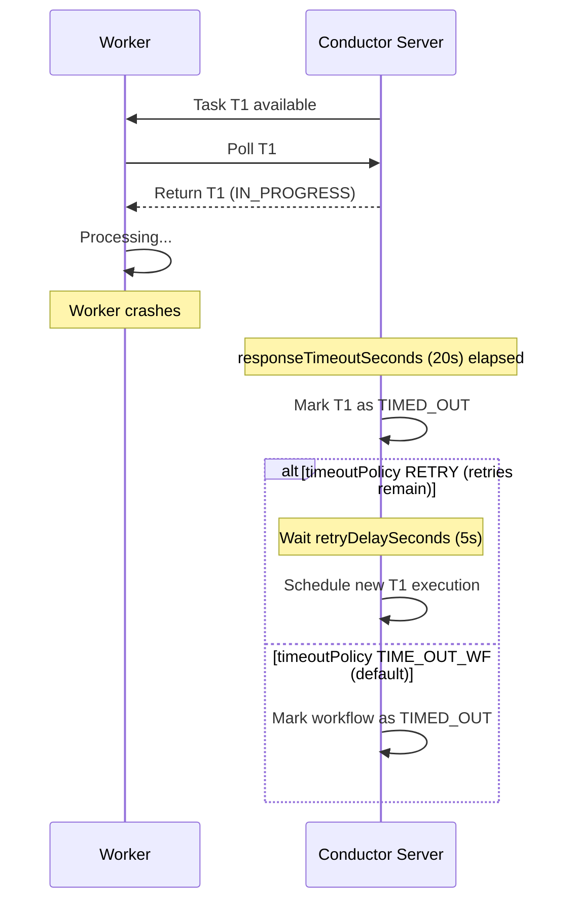
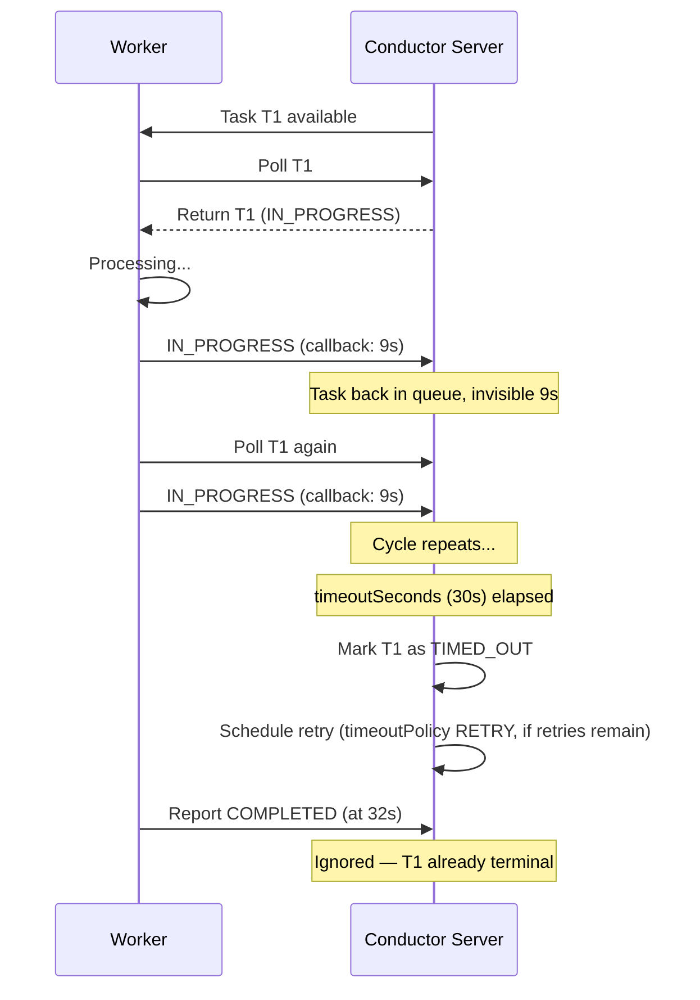
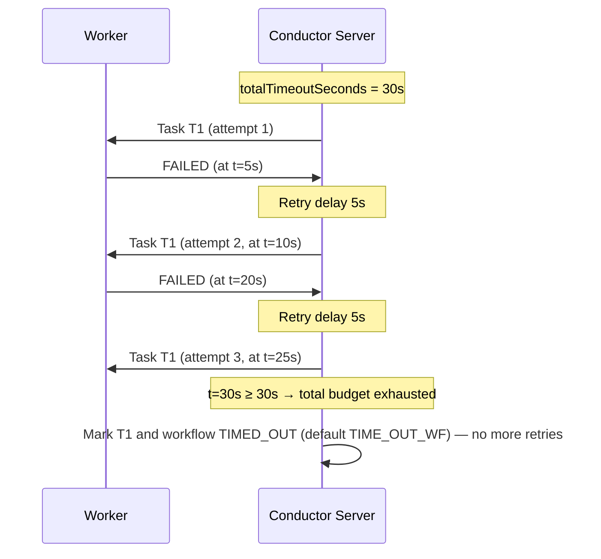

# Task Lifecycle

During a workflow execution, each task transitions through a series of states. Understanding these transitions is key to configuring retries, timeouts, and error handling correctly.

## State diagram

Every task starts in `SCHEDULED` when it enters its queue. A worker poll moves it to `IN_PROGRESS`, and a successful result moves it to `COMPLETED`. The other transitions cover failure: `FAILED` tasks return to `SCHEDULED` for retry until their retries are exhausted, `TIMED_OUT` tasks do so only when the task definition's `timeoutPolicy` is `RETRY` (see [Timeout scenarios](#timeout-scenarios)), and every other state is terminal. A retry schedules a new task execution with a new task ID; the failed or timed-out execution stays in its terminal state.

## Task statuses

| Status | Description |
| :--- | :--- |
| `SCHEDULED` | Task is queued and waiting for a worker to poll it. |
| `IN_PROGRESS` | A worker has picked up the task and is executing it. |
| `COMPLETED` | Task completed successfully. |
| `FAILED` | Task failed due to an error. Conductor will retry based on the task definition's retry configuration. |
| `FAILED_WITH_TERMINAL_ERROR` | Task failed with a non-retryable error. No retries will be attempted. |
| `TIMED_OUT` | Task exceeded its configured timeout. With `timeoutPolicy: RETRY`, Conductor retries it based on the retry configuration. With `TIME_OUT_WF` (the default), the workflow times out. |
| `CANCELED` | Task was canceled because the workflow was terminated. |
| `SKIPPED` | Task was skipped via the [Skip Task API](../../documentation/api/workflow.md#skip-task) before it was scheduled. When the flow reaches it, it counts as finished and the workflow continues to the next task, whether it is the first task, the next task in a list, a fork branch, or a switch case. Skipping a `FORK_JOIN` or `FORK_JOIN_DYNAMIC` also skips its `JOIN`. |
| `COMPLETED_WITH_ERRORS` | Task failed but is marked as optional in the workflow definition. The workflow continues. |

## Retry behavior

When a task fails with a retryable error, Conductor automatically reschedules it after the configured delay.

Retry behavior is controlled by the task definition:

| Parameter | Description |
| :--- | :--- |
| `retryCount` | Maximum number of retry attempts. |
| `retryLogic` | `FIXED`, `EXPONENTIAL_BACKOFF`, or `LINEAR_BACKOFF`. See [Retry Logic](../../documentation/configuration/taskdef.md#retry-logic). |
| `retryDelaySeconds` | Base delay between retries. |
| `maxRetryDelaySeconds` | Caps the computed delay. Prevents exponential growth from becoming arbitrarily large. |
| `backoffJitterMs` | Adds random milliseconds to each delay to spread concurrent retries over time. |
| `totalTimeoutSeconds` | Hard wall-clock budget across all attempts. See [Total timeout](#total-timeout). |

## Timeout scenarios

Every timeout below (poll, response, task, and total) applies the task definition's `timeoutPolicy`:

- `RETRY`: the task is marked `TIMED_OUT` and retried like any failed attempt, while `retryCount` allows.
- `TIME_OUT_WF` (default): the task is marked `TIMED_OUT` and the workflow is marked `TIMED_OUT`.
- `ALERT_ONLY`: the timeout is only logged and counted. The task's status is not changed.

### Poll timeout

If no worker polls the task within `pollTimeoutSeconds`, it is marked as `TIMED_OUT`.

This typically indicates a backlogged task queue or insufficient workers.

### Response timeout

If a worker polls a task but doesn't report back within `responseTimeoutSeconds`, the task's `timeoutPolicy` is applied, the same as for `timeoutSeconds`. Under `RETRY` and `TIME_OUT_WF` the task is marked as `TIMED_OUT`. This handles cases where a worker crashes mid-execution. To have Conductor retry the task on another worker, set `timeoutPolicy` to `RETRY`; under the default `TIME_OUT_WF`, a response timeout times the workflow out.

Workers can extend the response timeout by sending `IN_PROGRESS` status updates with a `callbackAfterSeconds` value.

### Task timeout

`timeoutSeconds` is the overall SLA for task completion. Even if a worker keeps sending `IN_PROGRESS` updates, the task is marked as `TIMED_OUT` once this duration is exceeded.

### Total timeout

`totalTimeoutSeconds` limits the total wall-clock time across **all** retry attempts. Once this budget is consumed, no further retries are scheduled regardless of how many remain in `retryCount` (unless `timeoutPolicy` is `ALERT_ONLY`, in which case the budget is only logged). The budget runs from when the task was first scheduled and carries across automatic retries. An operator's retry (`POST /api/workflow/{workflowId}/retry`) or a rerun starts the task with a fresh budget.

This is useful when you need a hard SLA on how long a task can run across all its attempts, independent of how many retries are configured.

## Timeout configuration summary

| Parameter | Description | Default |
| :--- | :--- | :--- |
| `pollTimeoutSeconds` | Max time for a worker to poll the task. | No timeout |
| `responseTimeoutSeconds` | Max time for a worker to respond after polling. Exceeding it applies `timeoutPolicy`. | 3600s |
| `timeoutSeconds` | SLA per individual attempt (from first `IN_PROGRESS` to terminal). | No timeout |
| `totalTimeoutSeconds` | Hard budget across all attempts combined. Overrides `retryCount`. | No timeout |
| `timeoutPolicy` | Action on any of the timeouts above: `RETRY`, `TIME_OUT_WF` (time out the workflow), or `ALERT_ONLY`. | `TIME_OUT_WF` |
